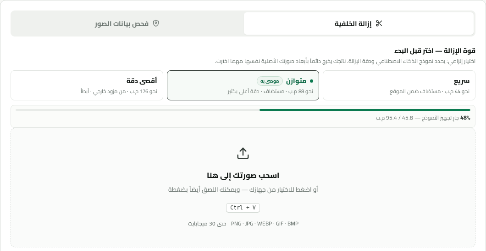
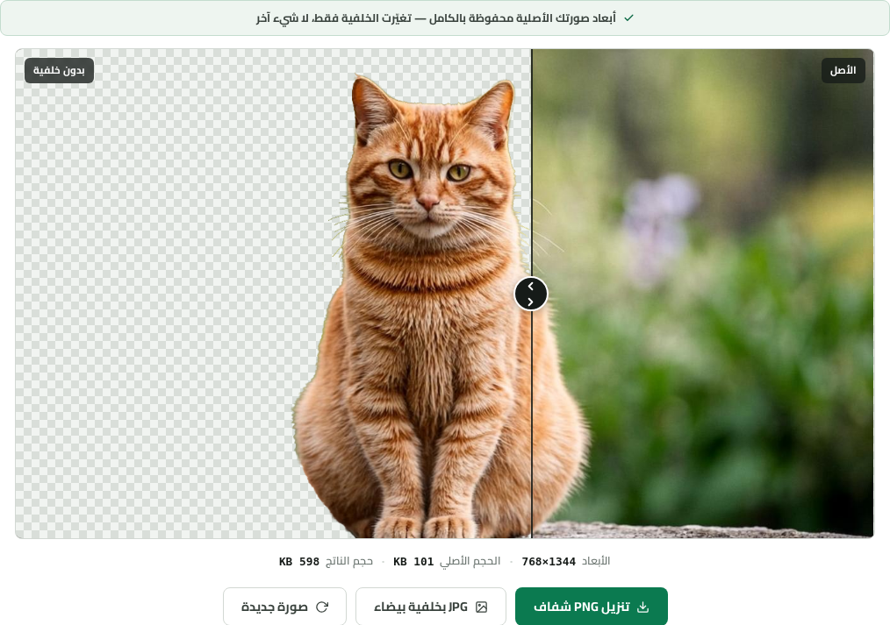
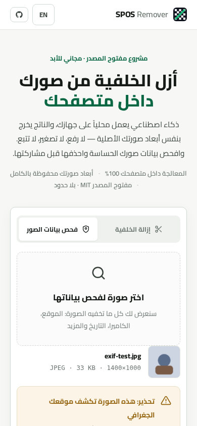
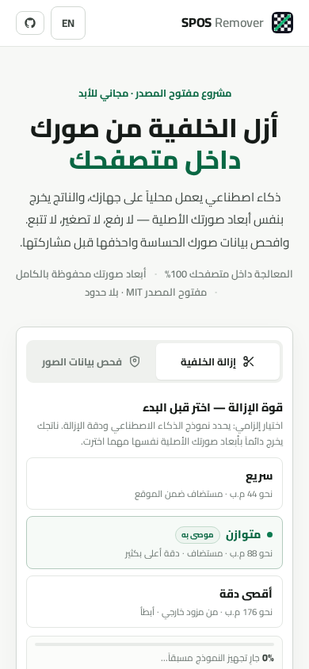

<div align="center">


# SPOS Remover

**منظومة إزالة متكاملة داخل متصفحك — An in-browser removal suite**

إزالة خلفية الصور بالذكاء الاصطناعي + فحص وحذف بيانات EXIF الحساسة،
محلياً 100% دون رفع أي صورة إلى أي سيرفر — والناتج يخرج بنفس أبعاد صورتك الأصلية.

AI background removal + EXIF/GPS metadata inspection & stripping —
everything runs on your device, output keeps your original dimensions,
nothing is ever uploaded.

[](LICENSE)
[](https://spos-systems.github.io/SPOS-Remover/)
[](CONTRIBUTING.md)
[](https://spos.ly)

**الرابط / Live**: <https://spos-systems.github.io/SPOS-Remover/>

</div>

---

## المزايا | Features

| | |
|---|---|
| إزالة الخلفية بالذكاء الاصطناعي | نموذج **ISNet** يعمل عبر WebAssembly داخل متصفحك — فصل دقيق للأشخاص والمنتجات والكائنات، بدون سيرفر وبدون تكاليف API |
| **أبعادك الأصلية محفوظة** | الناتج يخرج بنفس أبعاد صورتك الأصلية بالكامل وبكسلاتك نفسها — لا تصغير ولا اقتصاص؛ خيار «قوة الإزالة» يخص النموذج فقط |
| **قوة إزالة إلزامية (v1.5.0)** | لا خيار افتراضي صامت: سريع (~44MB) · متوازن (**موصى به، ~88MB**) · أقصى دقة (~176MB) — تختارها قبل البدء وتُخزَّن مرة واحدة |
| **تحسين حواف تلقائي (v1.5.0)** | بعد النموذج يجري تحسين حواف خاص: تصفية موجَّهة تُحكِم حواف الشعر والتفاصيل، إزالة البقايا العالقة، وملء الثقوب الصغيرة |
| **أرقام تنزيل حقيقية (v1.5.0)** | شريط التنزيل يعدّ بايتات مُبثّة فعلياً من إجمالٍ معروف — نسبة واحدة لا تعود للصفر ولا تقفز، وجزء التنزيل يبدأ عند اختيارك القوة قبل رفع أي صورة |
| مقارنة قبل/بعد | شريط تمرير تفاعلي فوق خلفية شطرنجية تُظهر الشفافية، مع دعم لوحة المفاتيح |
| تصدير مرن | PNG شفاف مباشرة من النموذج، أو JPG بخلفية بيضاء |
| فحص بيانات EXIF | محلل خاص بدون اعتماديات يدعم JPEG (EXIF/ICC/IPTC) وPNG (tEXt/eXIf/tIME) وWebP (EXIF/XMP) |
| كشف الموقع الجغرافي | تحذير أحمر عند وجود إحداثيات GPS مع رابط عرض الموقع الدقيق على الخريطة |
| نسخة نظيفة بضغطة | إعادة ترميز محلية تُسقط كل بايتات البيانات الوصفية مع بقاء البكسلات وأبعاد الصورة كما هي |
| إدخال من أي مكان | سحب وإفلات، اختيار ملف، أو لصق مباشر من الحافظة `Ctrl+V` |
| خصوصية مطلقة | لا حسابات، لا كوكيز، لا تحليلات، لا تتبع — موقع ثابت بالكامل [سياسة الخصوصية](privacy.html) |
| PWA كامل + نموذجان محليان | يثبَّت كتطبيق على أندرويد/iPhone/سطح المكتب؛ **النموذجان السريع والمتوازن مستضافان ضمن الموقع نفسه** فيعملان دون أي مزود خارجي، وتخزنهما الـSW للعمل دون إنترنت |
| عربي أولاً | واجهة RTL كاملة بخط Cairo + تبديل فوري للإنجليزية |

**AI background removal** runs the ISNet segmentation model locally via WebAssembly — precise cutouts of people, products and objects, at three strengths, with a draggable before/after slider and transparent-PNG / white-JPG export. Output **always keeps your original image dimensions and pixels**. **The EXIF inspector** has its own zero-dependency parser (JPEG/PNG/WebP), flags GPS coordinates and serials in red, links the exact location on a map, and exports a pixel-identical clean copy. Since v1.2.0 **the whole default path is in-repo**: the AI ENGINE is vendored (`assets/vendor/`) and since v1.5.0 **two model tiers are self-hosted** (`assets/models/`: fast ~44MB and the recommended balanced ~88MB) — the default experience depends on no external CDN at all, so it works even on networks that block public CDNs. An **edge-refinement pass** (guided filter + debris cleanup + hole filling) runs after the model to tighten hair and fine edges.

## الصفحة | Screenshots

<p align="center">
  
  <br>
  
  <br>
  
  <br>
  
</p>

> لقطات التوثيق مولّدة من صورة ديمو **محايدة** (قطة) مرّت عبر الـ pipeline الحقيقي نفسه — ناتج الإزالة في لقطة النتيجة هو ناتج فعلي للنموذج وليس مونتاجاً. لا توجد ولا تُسمح أي صور شخصية في هذا المستودع إطلاقاً.
> All screenshots come from a **neutral** demo subject (a cat) run through the genuine pipeline — the removal result shown is real model output. No personal photos exist or are permitted in this repository, ever.

## كيف يعمل؟ | How it works

الموقع ثابت بالكامل (HTML/CSS/JS بدون خطوة بناء وبدون اعتماديات مضمّنة):

- **إزالة الخلفية**: منذ v1.2.0 **محرك AI مضمّن داخل المستودع** في `assets/vendor/` (مكتبة `@imgly/background-removal` + onnxruntime-web — انظر `assets/vendor/NOTICE.md`)، فلا يعتمد المسار الافتراضي على أي CDN خارجي — يعمل حتى على الشبكات التي تحجب jsDelivr/esm.sh. **النموذجان السريع (isnet_quint8 ~44MB) والمتوازن (isnet_fp16 ~88MB) مستضافان ذاتياً في `assets/models/`** — والمستوى «أقصى الدقة» (isnet، ~176MB) يُنزّل من مزود imgly العام عند اختياره مع تحويل تلقائي للمتوازن المحلي إن فشل الاتصال بالمزود.
- **تحسين الحواف (v1.5.0)**: بعد النموذج يعمل تحسين حواف محلي في `assets/js/ai.js`: تصفية موجَّهة (Guided Filter) تنجز حواف الشعر والتفاصيل بالاستناد إلى حواف صورتك الأصلية، ثم إزالة البقايا العالقة عبر مكوّنات متصلة، وملء الثقوب الصغيرة داخل الموضوع، ومنحنى S لطيف يُحكِم الحواف الرخوة ويبقي نعومة الشعر الطبيعية.
- **أرقام حقيقية (v1.5.0)**: جزء التنزيل يعرف إجمالي البايتات من بيان الموارد مسبقاً ويعرض بايتات مُبثّة فعلياً (شريط لا يعود للصفر ولا يقفز)، ويبدأ عند اختيار قوة الإزالة — قبل رفع الصورة — فتكون المعالجة فورية بمجرد وصولها.
- **فحص EXIF**: محلل بايتات خاص بنا (`assets/js/exif.js`) يقرأ مقاطع الملف مباشرة — لا توجد مكتبات خارجية ولا أي طلب شبكي إطلاقاً.
- **الحذف**: إعادة ترميز الصورة على Canvas محلياً — البكسلات وأبعاد الصورة تبقى، البيانات تختفي.
- **دون إنترنت**: service worker يخزّن هيكل التطبيق **وقطع النموذج** مسبقاً؛ فتعمل الأداة بأكملها (بما فيها إزالة الخلفية بالقوتين السريع والمتوازن) دون إنترنت بعد أول استخدام. قطع مستوى «أقصى الدقة» من مزود imgly تُخزَّن أيضاً في ذاكرة الـSW (استجابات CORS) بعد أول تنزيل.
- **صمود الشبكة الضعيفة (v1.3.0)**: service worker يعيد محاولة كل قطعة نموذج متعثّرة تلقائياً (حتى 3 محاولات بتدرّج زمني)، والمحرك يعيد المحاولة على مستوى العملية نفسها — القطع التي نُزّلت تبقى محفوظة فلا يُعاد تنزيلها. عند أي فشل تُعرض الرسالة الحقيقية مع تفاصيل تقنية وزر إبلاغ دعم عبر واتساب، وعملية فحص توافق WebAssembly/SIMD مسبقة تمنع الفشل الصامت على المتصفحات القديمة.

> ملاحظة ترخيص: كود هذا المستودع MIT. منذ v1.2.0 ميزة إزالة الخلفية **مضمّنة** في المستودع: `assets/vendor/` يحوي مكتبة AGPL-3.0 وonnxruntime-web (MIT) بتراخيصها ونسخة AGPL كاملة وNOTICE — التطبيق المنشور كعمل مركب يخضع لشروط AGPL-3.0 لذلك المكوّن، والمستودع مفتوح المصدر بالكامل بما يتوافق معها. إن أردت نسخة MIT خالصة فاحذف مجلد `assets/vendor/` واستيراده في `assets/js/ai.js` (يعود للتحميل من CDN وقت التشغيل). قطع النموذج في `assets/models/` مقسمة من `@imgly/background-removal-data` (ترخيص الشركة المصنعة للنموذج يسري عليها كما هو).

### معاملات URL | URL parameters

| المعامل | الوصف |
|---|---|
| `?lang=ar` أو `?lang=en` | فتح الأداة بلغة محددة |
| `?tool=bg` | فتح تبويب إزالة الخلفية مباشرة |
| `?tool=exif` | فتح تبويب فحص البيانات مباشرة |

## التشغيل محلياً | Run locally

```bash
git clone https://github.com/spos-systems/SPOS-Remover.git
cd SPOS-Remover
python3 -m http.server 8000
# افتح http://localhost:8000
```

## البنية | Structure

```
index.html              الصفحة الوحيدة (منظومة الإزالة)
privacy.html            سياسة الخصوصية
assets/css/style.css    نظام التصميم الفاتح النظيف (خلفية فاتحة + زمردي واحد + حدود رفيعة)
assets/css/fonts.css    خط Cairo مستضاف ذاتياً (OFL)
assets/js/app.js        واجهة التحكم والتبويبات وi18n
assets/js/ai.js         وحدة إزالة الخلفية (محرك مضمّن + نموذج ذاتي الاستضافة)
assets/js/exif.js       محلل EXIF/البيانات الوصفية (بدون اعتماديات)
assets/js/i18n.js       قاموس العربية / English
assets/vendor/          محرك AI مضمّن (background-removal + onnxruntime-web + تراخيصها)
assets/models/          قطع نموذجي ISNet السريع والمتوازن + WASM (مستضافة ذاتياً ~44+88MB)
sw.js                   service worker (يخزن التطبيق والنموذج للعمل دون إنترنت)
manifest.webmanifest    بيان التطبيق + اختصارات التثبيت
robots.txt              يسمح صراحة لزواحف الذكاء الاصطناعي (GEO)
sitemap.xml             خريطة الموقع مع hreflang عربي/إنجليزي
llms.txt, llms-full.txt توثيق شامل لمحرّكات الذكاء الاصطناعي
docs/screenshots/       لقطات الشاشة
```

## المساهمة | Contributing

انظر [CONTRIBUTING.md](CONTRIBUTING.md) — المساهمات والترجمات والأفكار مرحّب بها. التقارير الأمنية في [SECURITY.md](SECURITY.md).

## الترخيص | License

[MIT](LICENSE) © SPOS — [صولة للأنظمة](https://spos.ly)

<p align="center"><sub>من تطوير صولة للأنظمة SPOS · <a href="https://spos.ly">spos.ly</a> · ليبيا</sub></p>
